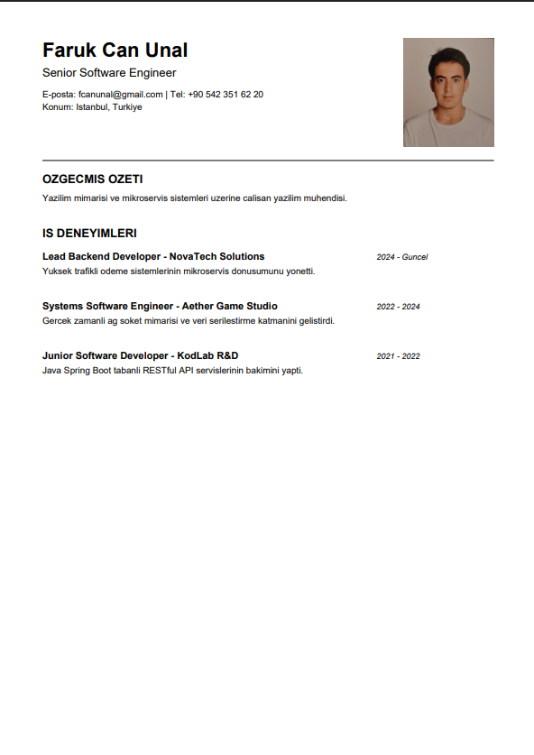

# Java PDF Özgeçmiş (CV) Oluşturucu

Bu proje, Java programlama dili ve Apache PDFBox kütüphanesi kullanılarak Nesne Yönelimli Programlama (OOP) prensiplerine uygun biçimde geliştirilmiş konsol tabanlı bir özgeçmiş (CV) oluşturucudur. Girilen kişisel bilgileri, profil fotoğrafını ve 3 farklı iş deneyimini hiyerarşik bir veri yapısında işleyerek formatlı bir A4 PDF çıktısı üretir.

---

## Örnek Çıktı

<!-- Not: PDF'in ekran görüntüsünü alıp (örn: cv-ornek.png) projenin ana dizinine yükleyin -->

---

## Proje Özellikleri

- **Nesne Yönelimli Mimari:** Veri modelleri, iş mantığı ve uygulama giriş noktası tamamen birbirinden ayrılmıştır.
- **Dinamik Veri Yönetimi:** Kişisel profil bilgileri ve sınırsız/çoklu iş deneyimi `List` koleksiyonları ile yönetilir.
- **Fotoğraf Desteği:** `PDImageXObject` kullanılarak adayın vesikalık/profil fotoğrafı sayfaya otomatik ölçeklenerek basılır.
- **Türkçe Karakter Filtresi:** Apache PDFBox'ın varsayılan WinAnsi/Helvetica font kodlamasında çökme (`dotlessi` / `IllegalArgumentException`) yaşanmaması için özel karakter filtreleme katmanı içerir.
- **Arayüzsüz ve Hızlı:** Konsol üzerinden doğrudan çalıştırılabilir, ek UI bağımlılığı gerektirmez.

---

## Kullanılan Teknolojiler ve Bağımlılıklar

- **Java** (JDK 8 veya üzeri)
- **Apache PDFBox 2.0.30:** PDF dokümanı oluşturma, metin yerleşimi ve çizim operasyonları.
- **Apache FontBox 2.0.30:** PDF fontlarının taranması ve yönetimi.
- **Apache Commons Logging 1.2:** Kütüphane içi loglama mekanizması.

---

## Kullanılan Sınıflar, Nesneler ve Tasarım Mimarisi

Ödev yönergesinde belirtilen *"PDF özgeçmişiniz direkt main içinde değil ayrı bir sınıfta yapılan işlem olarak kodlanacaktır"* kuralı ve **Tek Sorumluluk İlkesi (Single Responsibility Principle - SRP)** doğrultusunda şu sınıflar tasarlanmıştır:

### 1. `ResumeProfile` (Model Sınıfı)
- **Neden Kullanıldı?:** Adaya ait kişisel verileri (ad-soyad, unvan, e-posta, telefon, konum, biyografi özeti ve profil fotoğrafı dosya yolu) tek bir çatı altında kapsüllemek (Encapsulation) amacıyla oluşturulmuştur.
- **Nesne İlişkisi:** Bünyesinde `List<Experience>` tipinde bir liste tutarak adayın iş deneyimlerini hiyerarşik biçimde saklar.
- **Erişim Belirteçleri:** Tüm alanlar veri güvenliği için `private` tanımlanmış, dış dünyadan erişim `public getter` metotları ile kontrollü hale getirilmiştir.

### 2. `Experience` (Model Sınıfı)
- **Neden Kullanıldı?:** 3 adet iş deneyimini (şirket adı, rol/pozisyon, çalışma aralığı ve iş tanımı) modüler ve bağımsız bir veri nesnesi olarak modellemek için kullanılmıştır.

### 3. `PdfResumeService` (İş Mantığı & Servis Sınıfı)
- **Neden Kullanıldı?:** PDF oluşturma, doküman akışları (Stream) ve görsel çizim işlemlerini `Main` sınıfından tamamen soyutlamak için tasarlanmıştır.
- **Kullanılan Temel PDFBox Nesneleri:**
  - `PDDocument`: PDF belgesini temsil eder; sayfaların eklenmesi ve dosyanın diske kaydedilmesinden sorumludur.
  - `PDPage`: Standart A4 boyutunda boş sayfa oluşturur.
  - `PDPageContentStream`: Sayfa üzerine çizgi, renk, metin ve resim gibi grafiksel içeriklerin yazılmasını sağlayan temel çizim akışıdır.
  - `PDImageXObject`: Harici profil fotoğrafını PDF formatına dönüştürüp sayfaya yerleştirir.
